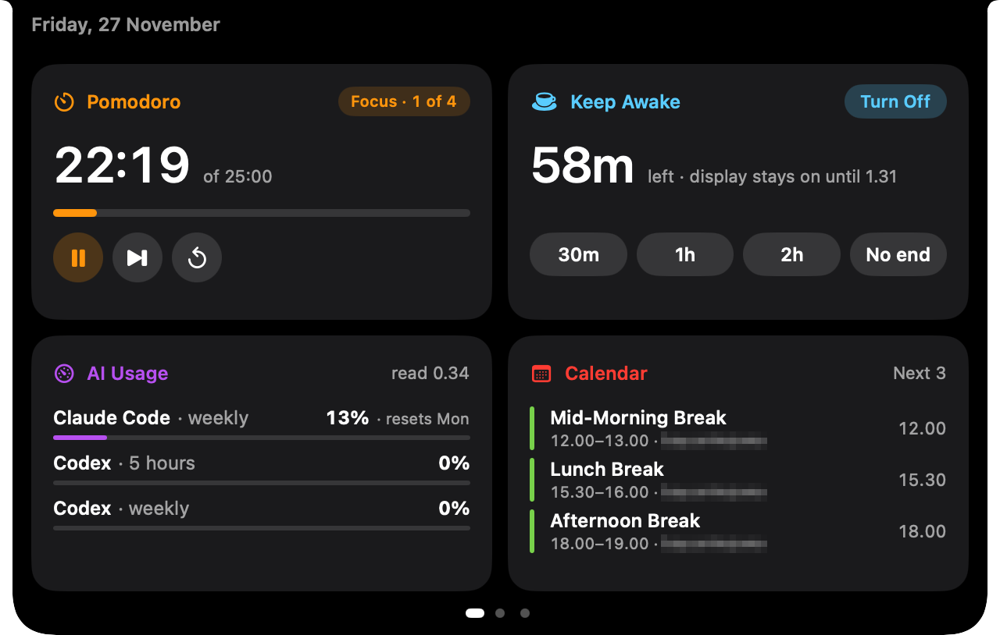
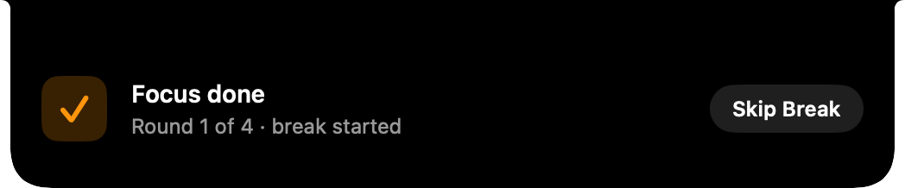
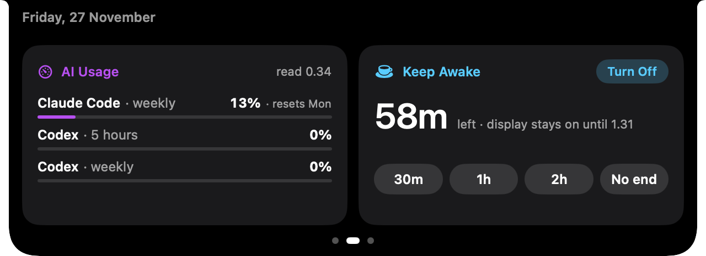
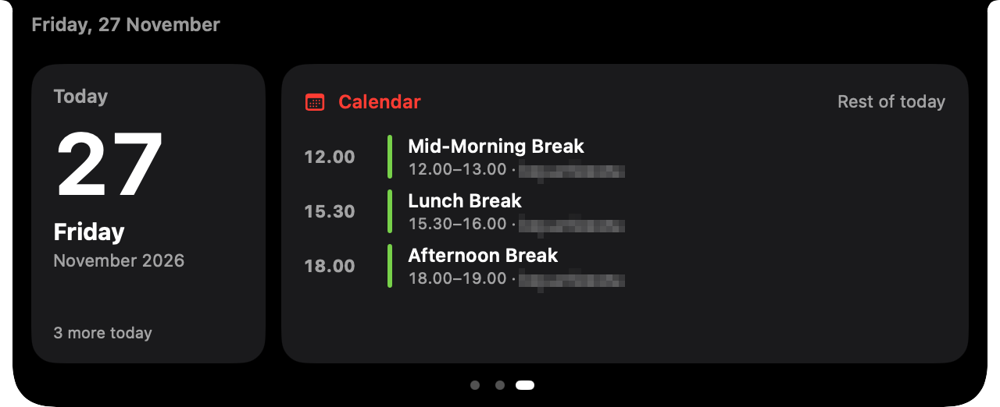
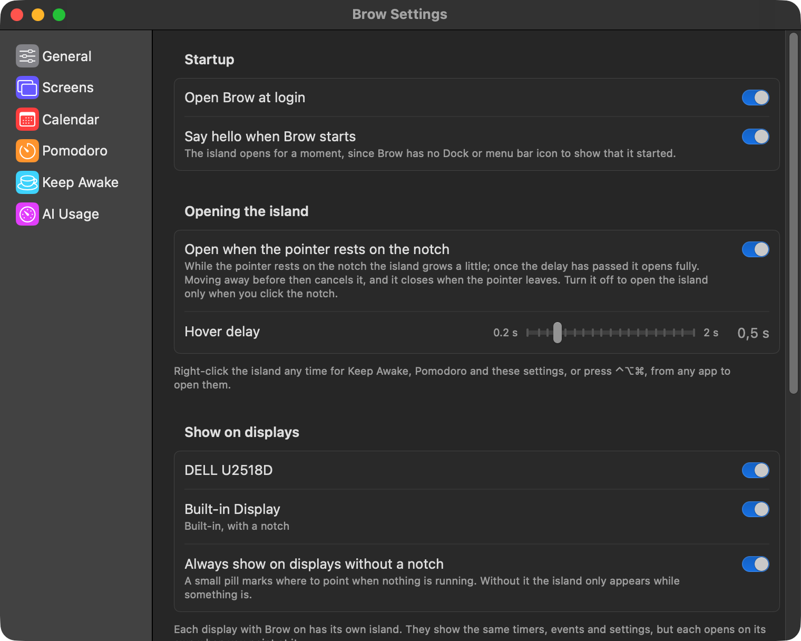
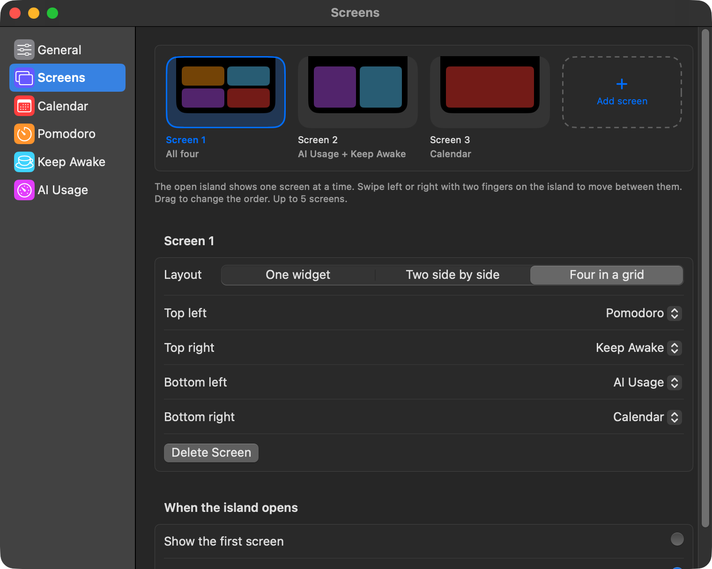
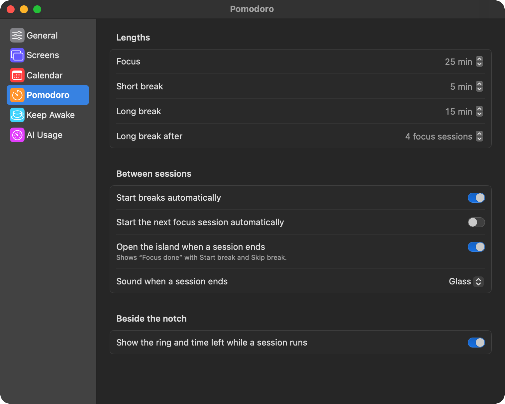
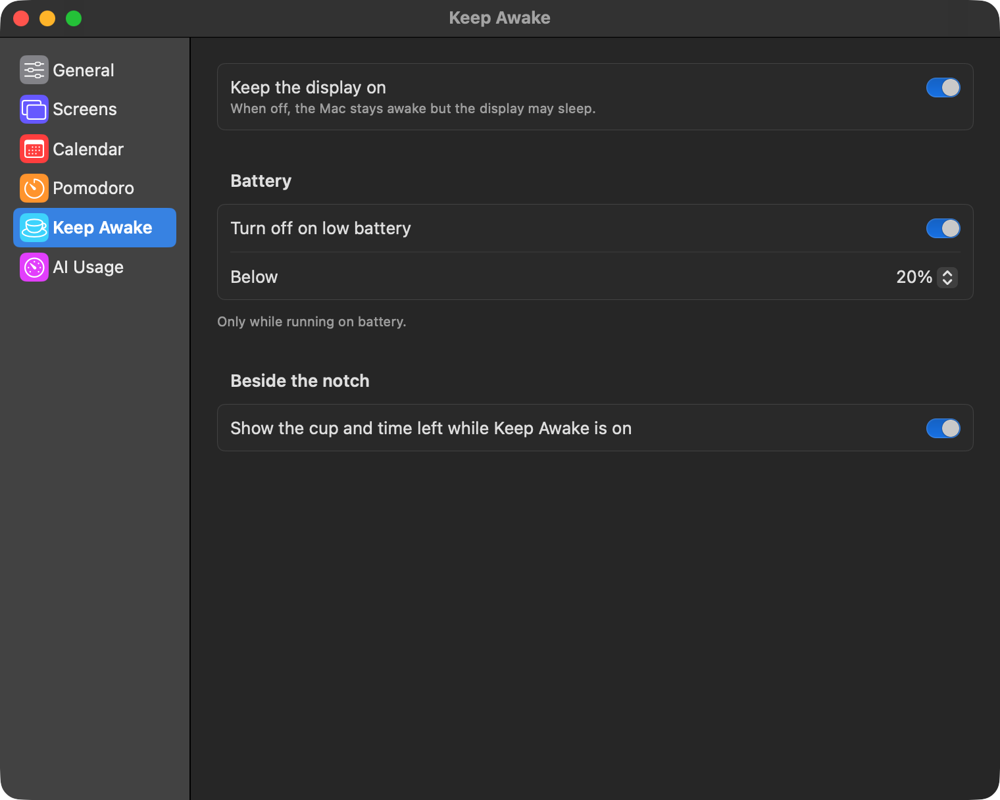
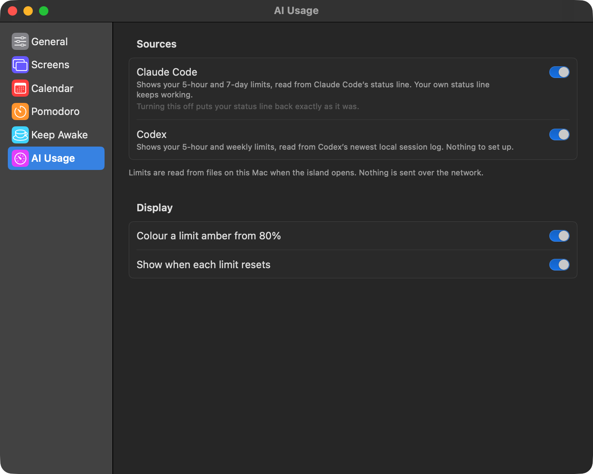

<h1 align="center">Brow</h1>

<p align="center">
  <b>Pomodoro, Keep Awake, your AI usage limits and your calendar, in the MacBook notch.</b><br>
  A small native Mac app. No Dock icon, no menu bar icon, no network.
</p>

<p align="center">
  <a href="https://github.com/renodesper/brow-app/actions/workflows/build.yml"></a>
  <a href="https://github.com/renodesper/brow-app/actions/workflows/release.yml"></a>
  
  
  <a href="LICENSE"></a>
  
  
</p>

<p align="center">
  
</p>

<p align="center">
  <a href="#what-it-does">What it does</a> ·
  <a href="#getting-around">Getting around</a> ·
  <a href="#install">Install</a> ·
  <a href="#settings">Settings</a> ·
  <a href="#build-from-source">Build from source</a> ·
  <a href="#how-it-stays-small-and-quiet">How it stays quiet</a> ·
  <a href="#where-things-are">Where things are</a>
</p>

Rest the pointer on the notch (or click it, if you prefer) and it opens into a screen of cards. Swipe left or right
with two fingers to see the others. When something is running, a little of it stays beside the notch.

## What it does

| | |
|---|---|
| ⏱ **Pomodoro** | Focus, short break, and a long break after every few focus rounds. Start, pause, skip, start over. A ring and the time left rest beside the notch while it runs, and the island opens a little when a phase ends, with Start Break and Skip Break. |
| ☕ **Keep Awake** | Keeps the Mac awake, and the display on unless you choose otherwise, for 30 minutes, 1 hour, 2 hours or until you turn it off (the right-click menu has more lengths). Can turn itself off when the battery runs low. |
| 📊 **AI Usage** | How much of your Claude Code and Codex limits you have used, and when they start over. Read from files on your Mac. |
| 📅 **Calendar** | Your next events today and tomorrow, from the calendars macOS already knows. An event shows beside the notch from 15 minutes before it starts ("in 12m", then "Now"), and the island opens for a moment as it starts. A Join button appears on events with a Zoom, Google Meet, Microsoft Teams or Webex link. |
| 🖥 **Every display** | One island per display, each opening on its own, all showing the same timers and events. Turn any of them off in Settings. A display without a notch keeps a small pill at the top, so there is something to point at. |
| 🎛 **Your screens** | Up to five screens of cards. Each screen shows one card across, two side by side, or four in a grid, with the cards you pick. |

<table>
  <tr>
    <td align="center"><br><sub>Beside the notch while something runs</sub></td>
    <td align="center"><br><sub>A peek when a phase ends</sub></td>
  </tr>
  <tr>
    <td align="center"><br><sub>Swipe to another screen</sub></td>
    <td align="center"><br><sub>Today's calendar</sub></td>
  </tr>
</table>

## Getting around

| To | Do this |
|---|---|
| Open the island | Click the notch, or turn on Settings → General → "Open when the pointer rests on the notch" and rest the pointer there. |
| Change screen | Swipe left or right with two fingers on the open island, or click a dot. |
| Keep Awake, Pomodoro, Settings, Quit | **Right-click** the island. |
| Open Settings from anywhere | **⌃⌥⌘,** (Control-Option-Command-Comma). It needs no permission. If another app already holds that combination, Brow has no shortcut and the Settings text does not mention one. |
| Open Settings the usual way | Open Brow again from Finder or Spotlight. |

## Install

1. Download `Brow-<version>.dmg` from the [releases page](https://github.com/renodesper/brow-app/releases).
2. Open it and drag **Brow** onto **Applications**.
3. Open Brow. It has no Dock icon: look at the notch, or right-click it.

Needs macOS 14 or later.

> **Heads up:** releases are not notarized yet, so macOS warns that the developer cannot be verified. Open Brow
> once, then go to System Settings → Privacy & Security and press **Open Anyway**. For the same reason, Calendar
> access is asked again after each update.

### Removing Brow

Deleting the app is enough, and it does not break anything. If you turned on AI Usage for Claude Code, a small
wrapper stays in the `statusLine` of `~/.claude/settings.json`: Claude Code's status line keeps working as before,
since the wrapper does not need Brow. It only keeps writing a small file into `~/Library/Application Support/Brow`
while that folder exists. To remove both, turn AI Usage for Claude Code off in Brow's Settings **before** deleting
the app: your own status line is put back exactly as it was (a backup sits beside the file as
`settings.json.brow-backup`).

## Settings

Settings follows light and dark mode (these are dark). Nothing here needs a login or the network.

Settings → General → **Show over full-screen apps** decides what the island does while an app is in full screen
on its display (a video, Safari, a Keynote slideshow): **Never** hides it (the default), **Only for alerts** hides it
but lets a peek through, such as a meeting starting or a Pomodoro session ending, and **Always** keeps it showing.

<table>
  <tr>
    <td align="center"><br><sub>General</sub></td>
    <td align="center"><br><sub>Screens</sub></td>
  </tr>
  <tr>
    <td align="center"><br><sub>Pomodoro</sub></td>
    <td align="center"><br><sub>Keep Awake</sub></td>
  </tr>
  <tr>
    <td align="center"><br><sub>AI Usage</sub></td>
    <td></td>
  </tr>
</table>

## Build from source

Needs macOS 14 or later and Xcode 15 or later (the full Xcode, not only the Command Line Tools: SwiftUI's `@State`
macro plugin ships with Xcode). No other tools, and no third-party packages.

```sh
make test      # unit tests for the logic
make run       # build, bundle into build/Brow.app, and open it
make install   # copy the app to /Applications
make dmg       # a disk image, build/Brow-<version>.dmg
```

The **Build** badge above is the same `swift test` and `swift build -c release` that run on every pull request.

macOS ties the Calendar permission to the app's signature. The default ad-hoc signature changes with every build,
so the permission is asked again after each rebuild. To keep it, sign with your own identity:

```sh
security find-identity -v -p codesigning
make run SIGN_ID="Apple Development: you@example.com (TEAMID)"
```

To keep the identity out of your commands, put `SIGN_ID := …` once in `Makefile.local` (not committed).

### Releasing

Publishing a release on GitHub builds a disk image and attaches it by itself. A build that other people can open
without a warning, signed with a Developer ID and notarized, is `make release` (or the same workflow, once the
secrets exist). See [docs/RELEASING.md](docs/RELEASING.md).

## How it stays small and quiet

- **Nothing polls.** The pointer is noticed by a tracking area. Usage files are read when the island opens. A
  running pomodoro holds one sleeping task until its phase ends; the countdown redraws once a second, and only
  while it is on screen. The calendar holds one sleeping task until the next event should appear, start or leave,
  and reads events again only when a calendar changes, the day changes or the Mac wakes.
- **Idle means idle.** With nothing running and no event near, the app has no repeating timers, no file watchers
  and no sockets.
- **One window per display.** Its frame is the island's own frame, so it never takes a click meant for something else.
- **Lazy.** The calendar store is created the first time it is needed: at launch once you have allowed access
  and events show beside the notch, otherwise never. Turn that off under Settings → Calendar to save its few megabytes.
- **No private APIs, no network, no login tokens.**

## AI usage: where the numbers come from

- **Codex** writes its limits into its session logs under `~/.codex/sessions`. The island reads the end of the
  newest log. Nothing to set up; numbers are as fresh as your last Codex reply.
- **Claude Code** pipes a JSON report, limits included, into its status-line command. Turning on
  **Claude Code** under Settings → AI Usage changes that command in `~/.claude/settings.json` to
  `tee <file> | ( your own command )`, so the island gets a copy and your status line looks as it did.
  The original file is kept beside it as `settings.json.brow-backup`, and turning the setting off puts
  your command back. Limits appear after the next reply in a Claude Code session, and only on a subscription plan.

## Where things are

```
Sources/BrowCore/          Logic with no UI, covered by Tests/
  Pomodoro.swift           The pomodoro cycle as a plain value; callers pass the time in
  Agenda.swift             Which event shows beside the notch, and when that next changes
  Usage.swift              Parsing of Claude Code's and Codex's own limit reports
  StatusLineHook.swift     Connecting and disconnecting Claude Code's status line
  IslandScreens.swift      The open island's screens and the two-finger swipe, as plain values
Sources/Brow/              The app
  BrowApp.swift            Entry point
  IslandDisplays.swift     One island per display, following displays being plugged in and out
  IslandController.swift   One island's window: where it sits, hover, click, right-click, swipe, opening and closing
  IslandView.swift         The island's shape, the closed, peeking and open layouts, the colours
  Cards.swift              The four cards, and the calendar's wide card for a screen of its own
  IslandMenu.swift         The right-click menu
  SettingsWindow.swift     The Settings window and its six panes
  AppModel.swift           The shared models, and what belongs to one display
  Preferences.swift        How the island opens, which displays, the screens
  KeepAwake.swift, PomodoroModel.swift, UsageModel.swift, CalendarModel.swift
Support/                   Info.plist and the entitlements (Calendar only)
scripts/make-dmg.sh        Wraps the app in a disk image
.github/workflows/         Build and test on every pull request; Release builds the disk image
docs/STATUS.md             Features, progress, what is not built, and what to improve
docs/RELEASING.md          Releasing, signing, notarization and Homebrew
docs/UI_MOTION.md          Notes on the island's motion
```

To add a feature: write an `@Observable` model, add it to `AppModel`, add a case to `Widget` in
`IslandScreens.swift`, a card in `Cards.swift`, and a pane in `SettingsWindow.swift`.

## Not built

Usage warnings at a threshold, other AI tools, hiding over full-screen apps, and "time to leave" (it needs your
location and a route lookup). See [docs/STATUS.md](docs/STATUS.md) for the whole picture.

## License

[MIT](LICENSE). Brow bundles no third-party code or fonts, so there is nothing else to credit.
